# agent-playbook

Personal collection of Claude Code commands, subagent definitions, and notes on how to orchestrate agents well.

## How `/lead` runs



Trivial work stays with the lead. Everything else runs as bounded phases: define the phase, delegate it to one worker, check the result against "done when", retry on a stronger model (a second failure goes to `oracle`), and synthesize when no phase remains. Source: `docs/lead-flow.html`.

## Layout

| Path | Contents |
|------|----------|
| `commands/` | Slash commands (`lead`, `pr-review`). Copy to `~/.claude/commands/`. |
| `agents/` | Subagent definitions (`scout`, `qa-runner`, `implementer`, `reviewer`, `deep-reasoner`, `oracle`). Copy to `~/.claude/agents/`. |
| `docs/orchestration-best-practices.md` | Sourced rules for delegation, model routing, briefs, and evals. |
| `docs/lead-review.md` | `/lead` checked against those rules, with gaps. |
| `docs/lead-flow.html`, `docs/lead-flow.svg` | The flowchart above and its source. |
| `docs/pr-review-research.md` | What published review systems do to catch real bugs without noise, and which of it `/pr-review` adopts. |

## Use

```sh
cp commands/*.md ~/.claude/commands/
cp agents/*.md ~/.claude/agents/
```

Then run `/lead <task>` in Claude Code.

## Add to this repo

Put new commands, agents, and findings here. Cite the source for every rule in `docs/`.
