# claude-code-tradecraft

A Claude Code plugin for people who want long tasks run by cheaper models under one lead, and for maintainers who want a PR review that posts only verified defects. Three skills (`/tradecraft:lead`, `/tradecraft:pr-review`, `/tradecraft:pr-review-watch`) and six model-routed subagents. Every rule in them traces to a cited source or a recorded run, or is listed as unmeasured in `docs/pr-review-research.md` section 17.

## Install

```
/plugin install tradecraft --marketplace kchojn/claude-code-tradecraft
```

The two-step form works on older versions of Claude Code:

```
/plugin marketplace add kchojn/claude-code-tradecraft
/plugin install tradecraft@claude-code-tradecraft
```

Update with `/plugin update tradecraft@claude-code-tradecraft`. Remove with `/plugin uninstall tradecraft@claude-code-tradecraft`.

Prerequisites:

- Claude Code 2.1.275 or later for the one-step install. The agents use `omitClaudeMd`, which needs 2.1.271 or later.
- `git`, `jq`, and `gh`. `gh` must be authenticated with access to the repositories you review.
- On macOS, GNU coreutils for `timeout`. The watcher uses it.
- Optional: the OpenAI Codex plugin for Claude Code, for the disputed-verdict escalation.

## What you get

| Command | What it does |
|---------|--------------|
| `/tradecraft:lead <task>` | Runs a task as bounded phases, delegating each to a worker on the cheapest model that can do it. |
| `/tradecraft:pr-review <PR number, URL, or branch> [--publish] [--deep] [--focus <text>]` | Reviews a PR with finders and a verifier. Dry run by default. |
| `/tradecraft:pr-review-watch [clone root]...` | One pass of a watcher that reviews PRs that requested your review. |

| Agent | Model | Effort | Access | Role |
|-------|-------|--------|--------|------|
| `tradecraft:scout` | haiku | medium | read-only, no CLAUDE.md, 40 turns | Finds files and symbols, reads logs, runs existing checks. |
| `tradecraft:qa-runner` | haiku | high | no edits, no CLAUDE.md, 80 turns | Runs manual and end-to-end test steps and reports pass or fail. |
| `tradecraft:implementer` | sonnet | medium | writes | Writes code from a spec and runs the existing checks. |
| `tradecraft:reviewer` | sonnet | high | read-only, no CLAUDE.md | Finds or verifies defects with `file:line` evidence. |
| `tradecraft:deep-reasoner` | opus | high | no edits | Designs and debugs by reading code. |
| `tradecraft:oracle` | fable | high | read-only | One escalation call when a phase has failed twice. |

Commands never pass `model`; the agent's frontmatter decides. The one exception is `model: opus` to retry a failed implementer phase.

## How /tradecraft:lead runs



Trivial work stays with the lead. Work of size S goes to one worker with a minimal brief and no phases. Everything else runs as bounded phases: define the phase, delegate it to one worker, and check the report against "done when". A failed phase retries on the same worker or a stronger one, and a second failure goes once to `tradecraft:oracle`. A disputed verdict can go to the Codex companion script when the OpenAI Codex plugin is installed. At most ten workers run in parallel. A worker report opens with `DONE`, `DONE_WITH_CONCERNS`, `NEEDS_CONTEXT`, or `BLOCKED`, and the final synthesis ends with Blocked on me, Changed, and Found.

## How /tradecraft:pr-review runs



The lead sorts the PR into a tier. A trivial PR stays with the lead, a normal one gets one recall-biased finder, a high-risk one gets two finders, the second reading the files in reverse order, and one verifier on `tradecraft:deep-reasoner`, and a large one gets one finder per subsystem. One precision-biased verifier tries to disprove each candidate and must cite `file:line`. Verdicts are CONFIRMED, PLAUSIBLE, or REFUTED, and confidence (does the defect exist) is kept apart from severity (does it block).

A CONFIRMED finding posts at any severity. A PLAUSIBLE one posts as `[Optional]` at confidence 70 or more, or 60 or more at MEDIUM severity or higher. The review event is REQUEST_CHANGES for HIGH or BLOCKER, COMMENT otherwise (REQUEST_CHANGES also for a MEDIUM whose impact blocks merge), and APPROVE when nothing is confirmed. A re-review covers only the commits the author added since the last reviewed head, so a rebase or a merge of the base does not reopen reviewed code. From the third round only MEDIUM and above post.

Run it from a local clone of the PR's repository. It adds a detached worktree at the head commit under `$TMPDIR`.

- `--publish` posts one GitHub review with the inline comments. Without it the run prints findings and dropped candidates and touches nothing on GitHub.
- `--deep` forces the high-risk tier.
- `--focus <text>` points the finders at a topic.

## How /tradecraft:pr-review-watch runs



One pass finds open, non-draft PRs that requested your review in the last 24 hours. It skips PRs already reviewed at their head commit and PRs with a result file for that head. It finds the local clone under your roots and never clones. It then runs one `claude -p "/tradecraft:pr-review <url> --publish"` per PR, three at a time, in a background batch. Each review is capped at 60 minutes and 10 USD. Run it on a timer with `/loop 15m /tradecraft:pr-review-watch`. A `/loop` expires after seven days and must be started again.

Roots come from the arguments or from `~/.config/pr-review-watch/roots`, one directory per line, `~` allowed. That file does not exist until you write it.

### Where its state lives

- `~/.cache/pr-review-watch/lock` exists while a batch runs.
- `~/.cache/pr-review-watch/results/<owner>/<repo>/<number>-<head7>.json` and `.err` hold the one attempt at that head.
- To retry a PR at the same head, delete its result file.

## Headless use

```sh
claude -p "/tradecraft:pr-review <url>"
claude -p "/tradecraft:pr-review <url> --publish"
```

The watcher starts its reviews this way.

## Layout

| Path | Contents |
|------|----------|
| `skills/lead/SKILL.md`, `skills/pr-review/SKILL.md`, `skills/pr-review-watch/SKILL.md` | The three commands. |
| `agents/` | The six subagent definitions. |
| `docs/orchestration-best-practices.md` | Sourced rules behind `/tradecraft:lead` and the agents. |
| `docs/pr-review-research.md` | What published review systems do, which of it `/tradecraft:pr-review` adopts, and recorded runs. |
| `docs/lead-review.md` | Each practice mapped to the line in the lead skill that implements it. |
| `docs/*-flow.html`, `docs/*-flow.svg` | The three flowcharts above. The HTML is the source. |
| `docs/social-preview.html`, `docs/social-preview.png` | The GitHub social preview card and its 1280x640 export. |
| `.claude-plugin/` | The plugin and marketplace manifests. |
| `CHANGELOG.md`, `CONTRIBUTING.md`, `LICENSE` | Release notes, how to contribute, and the license. |

## Why these rules

Prompt rules drift when nobody can say where they came from. Here each rule sits in a doc with its source: an official reference, a published system, or a measured run. The rules set without a source are listed in `docs/pr-review-research.md` section 17. `docs/orchestration-best-practices.md` holds the rules for delegation, model routing, and briefs. `docs/pr-review-research.md` holds what published review systems do and what the real runs showed. A skill changes only after its rule changes in the doc.

## Contributing

See `CONTRIBUTING.md`.

## License

MIT. See `LICENSE`.
